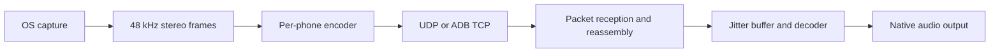

# Architecture

Gemacast consists of a Rust desktop streamer and a Tauri Android player.
The mobile interface uses React; the download website uses Vue.

## Audio pipeline

The PC owns capture and encoding. Each phone owns its transport receiver,
jitter buffer, decoder, and output stream. Control uses a separate HTTPS/WSS
connection.

## Where to make a change

| Component | Responsibility | Entry points |
| --- | --- | --- |
| Core capture | Platform selection and audio normalization | [Capture port](gemacast-core/src/ports/capture.rs), [adapters](gemacast-core/src/adapters/capture/) |
| Core streamer | Capture sharing, target encoders, pacing | [Streamer modules](gemacast-core/src/stream/streamer/) |
| Core player | Transport, packet reception, playback lifecycle | [Player modules](gemacast-core/src/stream/player/) |
| Core jitter | Ordering, buffering, decoding, concealment | [Jitter modules](gemacast-core/src/jitter/) |
| Core control | Pairing, tokens, HTTP routes, WebSocket events | [Control modules](gemacast-core/src/control/) |
| PC application | Tray, device registry, background tasks | [UI loop](gemacast-pc/src/app.rs), [composition root](gemacast-pc/src/background.rs) |
| Mobile native | Tauri commands, services, platform integration | [Composition root](gemacast-mobile/src-tauri/src/lib.rs), [services](gemacast-mobile/src-tauri/src/services/) |
| Mobile interface | React views, controllers, Zustand stores | [Application controller](gemacast-mobile/src/controllers/application-controller.ts), [native bridge](gemacast-mobile/src/core/tauri-bridge.ts) |
| Android integration | Activity, foreground service, JNI | [Kotlin sources](gemacast-mobile/src-tauri/gen/android/app/src/main/java/com/apir/gemacast/) |
| Website | Product information and downloads | [Website guide](web/README.md) |

The Cargo workspace contains `gemacast-core`, `gemacast-pc`, and
`gemacast-mobile/src-tauri`. Both JavaScript applications have separate manifests
and lockfiles.

## Capture and playback

[CapturePool](gemacast-core/src/stream/streamer/capture_pool.rs) shares a capture
between targets selecting the same source. It permits eight simultaneous
sources. Each target owns an encoder and bitrate; capture stops after its last
target unsubscribes.

Capture adapters convert input to interleaved stereo `f32` at 48 kHz. A 10 ms
frame contains 480 samples per channel: 960 samples or 3,840 PCM bytes.
Desktop capture uses WASAPI, PipeWire, or ScreenCaptureKit, with cpal fallbacks.
Per-process capture has no cpal fallback.

The player validates packet structure and reassembles UDP PCM before inserting
complete frames into the jitter pipeline. Android output uses Oboe;
non-Android output uses cpal.

| Jitter module | Responsibility |
| --- | --- |
| `buffer.rs` | Packet storage and sequence ordering |
| `stats.rs`, `target.rs` | Arrival statistics and buffer-target calculation |
| `flow.rs` | Prebuffering, starvation, recovery |
| `decoder.rs` | Decoding and packet-loss concealment |
| `timescale.rs` | Playback time-scale adjustment |
| `manager.rs` | Coordination |

Target calculation selects buffered depth; time-scale adjustment changes
playback consumption. Phones have independent playback clocks and buffers.

## Connection lifecycle

1. LAN discovery uses UDP presence/probes and mDNS. ADB discovery uses a
   forwarded TCP connection.
2. The phone authenticates through HTTPS using a P-256 challenge bound to the
   PC certificate. Initial pairing requires comparison-code confirmation.
3. The PC creates the source subscription, commits the session, and returns its
   token and generation. Mutating control requests authenticate the device ID
   against its token.
4. The phone receives audio and control events. Source or bitrate changes replace
   the affected subscription or encoder.
5. Session-generation checks reject stale cleanup and connections after a
   replacement session is established.

Implementation: [connect client](gemacast-core/src/control/http_connect.rs),
[HTTP handlers](gemacast-core/src/control/handlers.rs),
[PC dispatcher](gemacast-pc/src/tasks/control_dispatcher.rs), and
[mobile audio services](gemacast-mobile/src-tauri/src/services/audio/).

## Transport

Ports are defined in [network/ports.rs](gemacast-core/src/network/ports.rs).

| Channel | Endpoint | Format |
| --- | --- | --- |
| LAN discovery | UDP 23555 | Presence and probe messages |
| Control | PC TCP 23559 | HTTPS requests and WSS events |
| LAN audio | Phone UDP 23556 | Audio datagrams; PC source port is ephemeral |
| ADB audio | PC loopback TCP 23557 | Authenticated handshake, then length-prefixed audio |
| ADB discovery | PC loopback TCP 23558 | Newline-delimited control JSON |

USB tethering uses the LAN protocol. The
[ADB watchdog](gemacast-core/src/network/adb/reverse.rs) forwards TCP 23557,
23558, and 23559. The phone connects through loopback to the forwarded ports.
ADB audio authenticates device ID, session token, and generation using the
[audio handshake](gemacast-core/src/stream/player/handshake.rs).

Control uses TLS. LAN audio has no encryption or authentication; sequence and
generation fields identify ordering and sender replacement, not packet integrity.
ADB audio uses forwarded TCP without application-layer encryption.

## Audio wire format

The [base encoder](gemacast-core/src/stream/streamer/encode.rs) emits:

| Field | Bytes | Encoding |
| --- | --- | --- |
| Sequence | 8 | Big-endian `u64` |
| Format | 1 | `0`: Opus; `1`: PCM; `2`: silence |
| Payload | Variable | Opus bytes, 3,840 PCM bytes, or empty for silence |

PCM samples are native-endian `f32`; the integer headers are big-endian.
Silence packets contain only the nine-byte header. Format constants are in
[audio/mod.rs](gemacast-core/src/audio/mod.rs).

### UDP PCM

Each non-silent PCM frame is divided into four datagrams:

| Field | Bytes | Encoding |
| --- | --- | --- |
| Frame sequence | 8 | Big-endian `u64` |
| Format | 1 | `3`: chunked PCM |
| Sender generation | 8 | Big-endian `u64` |
| Chunk index | 1 | `0`–`3` |
| PCM slice | 960 | One quarter of the frame |

Each datagram is 978 bytes before UDP/IP headers. The sender transmits all four
on the 10 ms frame clock. The receiver releases a frame only after all chunks
arrive. Send age is limited to 40 ms; incomplete assemblies expire at 100 ms.

Implementation: [chunk format](gemacast-core/src/audio/pcm_datagram.rs),
[UDP sender](gemacast-core/src/stream/streamer/udp_audio_sender.rs),
[send-age limit](gemacast-core/src/stream/streamer/captured_frame.rs),
[reassembly](gemacast-core/src/stream/player/pcm_assembly.rs).

### ADB TCP

[TcpAudioFramer](gemacast-core/src/network/adb/framer.rs) prefixes each base
packet with its byte length as a four-byte big-endian integer. PCM remains a
complete frame; the UDP chunk layout is not used.

## Execution boundaries

| Boundary | Implementation |
| --- | --- |
| PC UI/background | Tao event loop and a separate Tokio runtime; `AppCommand` and `TrayEvent` carry messages |
| Mobile UI/native | Controllers call `tauri-bridge.ts`; Tauri commands delegate to native services |
| Native Android | Mobile platform facade calls Kotlin through JNI |
| Platform audio | Core port traits and concrete adapters |

Core ports are in `gemacast-core/src/ports/`; application ports are in each
application's `traits/` directory. Concrete implementations are composed in the
PC background engine and mobile `lib.rs`.

Development constraints are in [CLAUDE.md](CLAUDE.md). Build and validation
commands are in [CONTRIBUTING.md](CONTRIBUTING.md).
