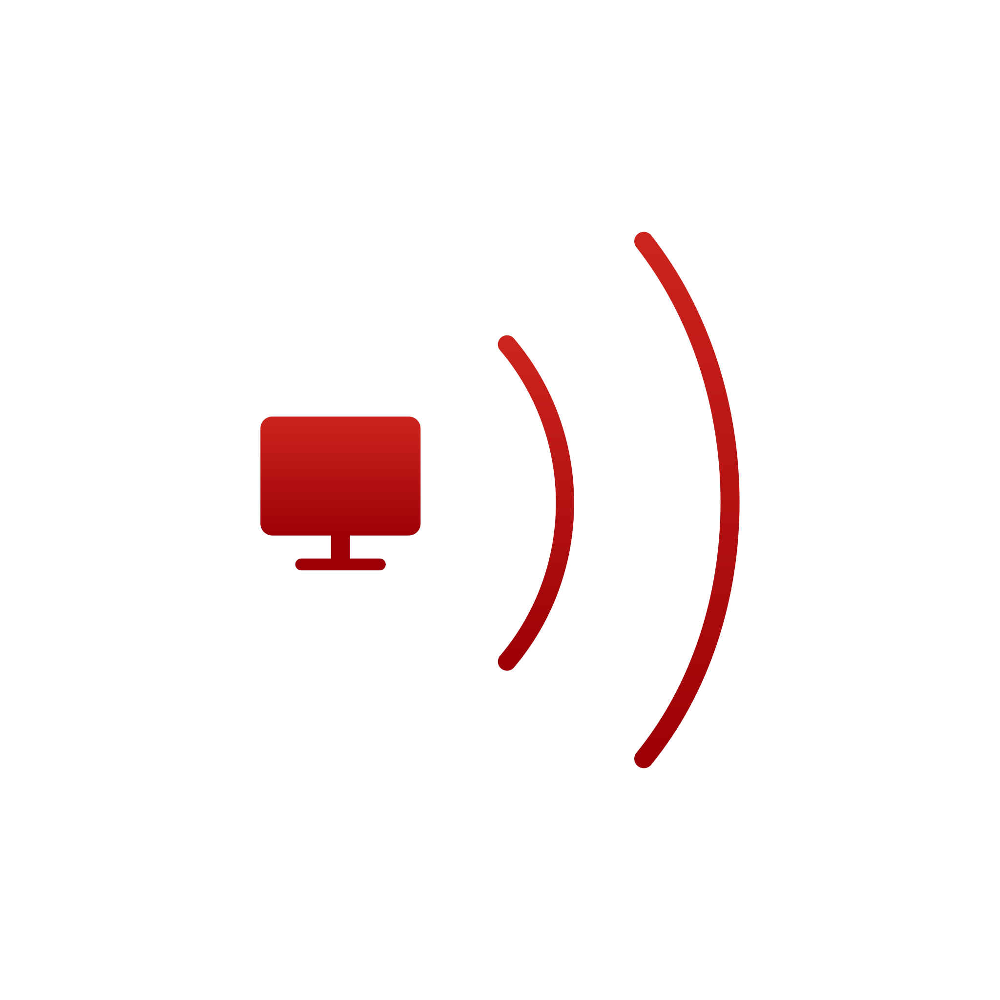
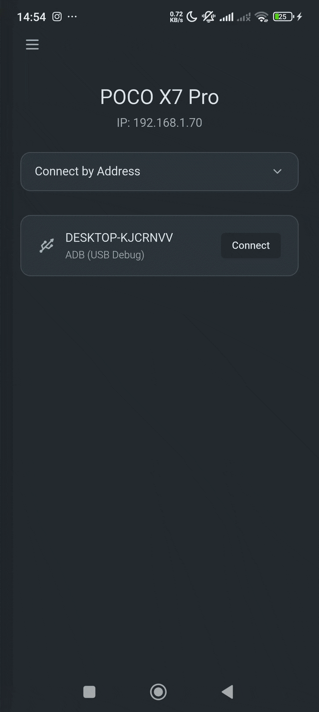
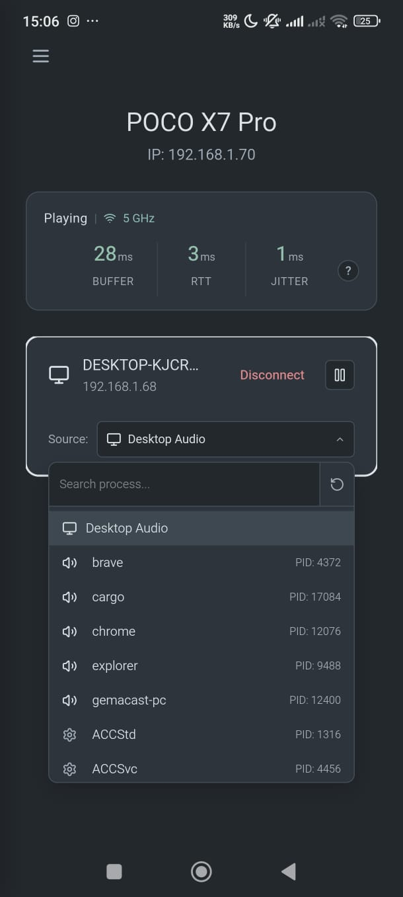
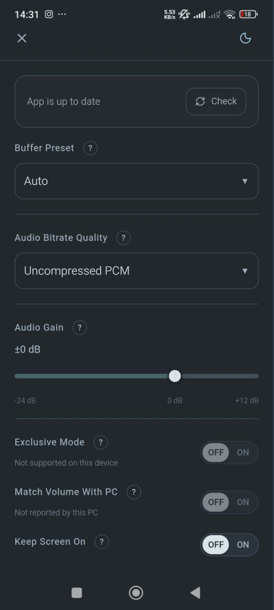
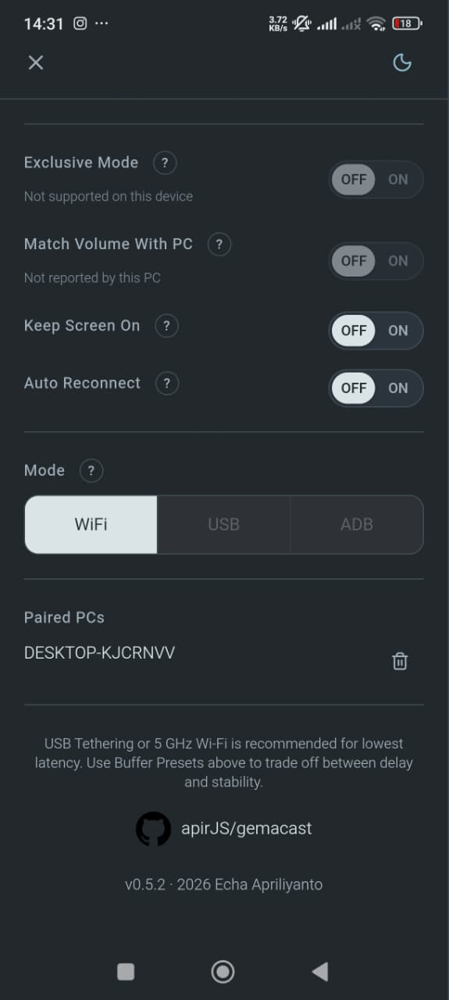
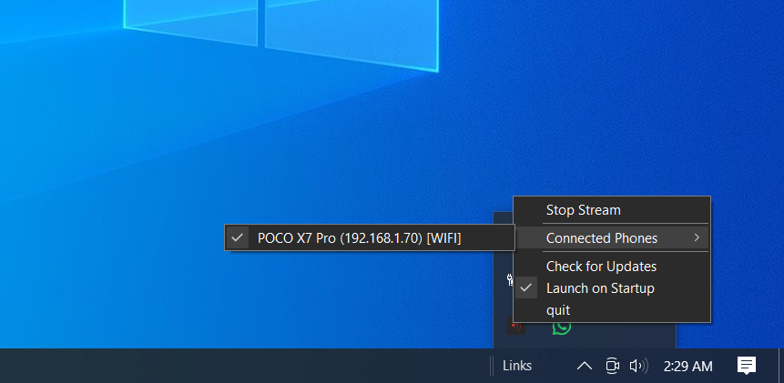

<div align="center">

#  Gemacast

[](https://github.com/apirJS/gemacast/releases/latest)
[](LICENSE)

PC-to-Android audio streaming over Wi-Fi, USB tethering, or ADB.

[Download](https://github.com/apirJS/gemacast/releases/latest) ·
[Architecture](ARCHITECTURE.md) · [Contributing](CONTRIBUTING.md) ·
[Changelog](CHANGELOG.md)

</div>

The desktop tray application captures system or per-application audio. Each
connected phone has independent source, bitrate, and playback-buffer settings.
Phones selecting the same source share capture, with separate encoders.

## Platforms

| Platform | Audio implementation |
| --- | --- |
| Windows | WASAPI desktop and per-process capture; cpal desktop fallback |
| Linux | PipeWire desktop and per-process capture; cpal desktop fallback |
| macOS 13+ | ScreenCaptureKit desktop and per-process capture; cpal desktop fallback |
| macOS 11–12 | cpal desktop capture; no per-process capture |
| Android 8.0+ (API 26) | Native playback through Oboe |

The macOS cpal path requires system audio routed to a capture device.
ScreenCaptureKit requires Screen Recording permission. iOS is not implemented.

## Installation

Packages are available on the [release page](https://github.com/apirJS/gemacast/releases/latest).

| Platform | Package |
| --- | --- |
| Windows | `.msi` installer or `.zip` archive |
| Linux | `.deb`, `.rpm`, `.AppImage`, or `.tar.xz` |
| macOS | `.dmg` |
| Android ARM64 | `gemacast-mobile.apk` |
| Android, multiple architectures | `gemacast-mobile-universal.apk` |

Linux package installation:

```bash
sudo apt install ./gemacast-pc_*.deb       # Debian / Ubuntu
sudo dnf install ./gemacast-pc-*.rpm      # Fedora
```

Linux archives require GTK3 and AppIndicator runtime libraries for the tray.
The Windows MSI installs firewall exceptions. Linux package scripts attempt
firewall configuration; portable archives and AppImages do not.

The macOS application is unsigned and unnotarized. To remove quarantine after
copying it into Applications:

```bash
xattr -d com.apple.quarantine /Applications/Gemacast.app
```

## Connection

1. Start the PC tray application and the Android application.
2. Configure a connection mode from the table below and select the PC on the phone.
3. During initial pairing, compare the six-digit code on both devices and approve.
4. Select desktop or application audio and start playback.

| Mode | Setup | Transport |
| --- | --- | --- |
| Wi-Fi | Connect both devices to the same reachable LAN | UDP audio; HTTPS/WSS control |
| USB tethering | Connect USB and enable Android USB tethering | Same protocol as Wi-Fi over the tethered interface |
| ADB | Enable USB debugging, connect USB, and approve the computer | TCP connections through automatic `adb reverse` |

LAN discovery can be blocked by client isolation, guest networks, VPN routing,
or firewall rules. ADB discovery uses the forwarded connection.

## Audio

All sources are converted to 48 kHz stereo. Each 10 ms frame contains 480 samples
per channel, or 960 interleaved samples.

| Format | Encoding | Audio payload rate |
| --- | --- | --- |
| Opus | LowDelay/CELT | 6–512 kbit/s |
| PCM | Native-endian `f32` stereo | 3.072 Mbit/s, excluding transport overhead |

Playback provides adaptive and fixed jitter-buffer presets, gain control,
optional PC-volume matching, and automatic reconnection. Each phone buffers
independently; playback is not synchronized across phones.

The displayed RTT and buffer depth do not measure capture-to-speaker latency.
Capture, encoding, network transport, decoding, and output buffers also
contribute to that delay.

## Authentication and privacy

- Control uses TLS and P-256 device authentication. Pairing compares a six-digit
  code; approved PC identities are stored on the phone.
- Session tokens are memory-only and rotate on connection. A changed PC
  certificate requires forgetting its stored identity before pairing again.
- UDP audio is neither encrypted nor authenticated. LAN streaming therefore
  requires a trusted network.
- An authenticated phone can request the PC process list to select an audio source.
- ADB audio passes through the approved debugging connection and has no separate
  audio encryption.

## Network ports

| Port | Protocol | Use |
| --- | --- | --- |
| 23555 | UDP | LAN discovery and probes |
| 23556 | UDP | Audio received by the phone |
| 23559 | TCP | HTTPS/WSS control received by the PC |

The PC sends audio from an ephemeral UDP port. The phone returns heartbeat and
RTT traffic to that sender port. Firewalls must allow the audio flow and replies.
ADB forwards TCP 23557 (audio), 23558 (discovery), and 23559 (control); it needs
no LAN firewall rule.

The Linux [firewalld service](linux/gemacast.firewalld.xml) includes UDP
23555–23556 and TCP 23559. Equivalent UFW rules:

```bash
sudo ufw allow 23555,23556/udp
sudo ufw allow 23559/tcp
```

## Interface

<div align="center">
  
</div>

<details>
<summary>Application selection, settings, and desktop tray</summary>
<br />




</details>

## Documentation

| Document | Content |
| --- | --- |
| [Architecture](ARCHITECTURE.md) | Components, session lifecycle, transport, and packet formats |
| [Contributing](CONTRIBUTING.md) | Setup, builds, checks, diagnostics, and issue/PR contents |
| [Development constraints](CLAUDE.md) | Repository-specific coding constraints |
| [Website](web/README.md) | Vue source map and commands |
| [Containers](docker/README.md) | Linux and Android check environments |

## License

[GPL-3.0-or-later](LICENSE). Third-party dependencies are listed in
[THIRD_PARTY_NOTICES.md](THIRD_PARTY_NOTICES.md).
